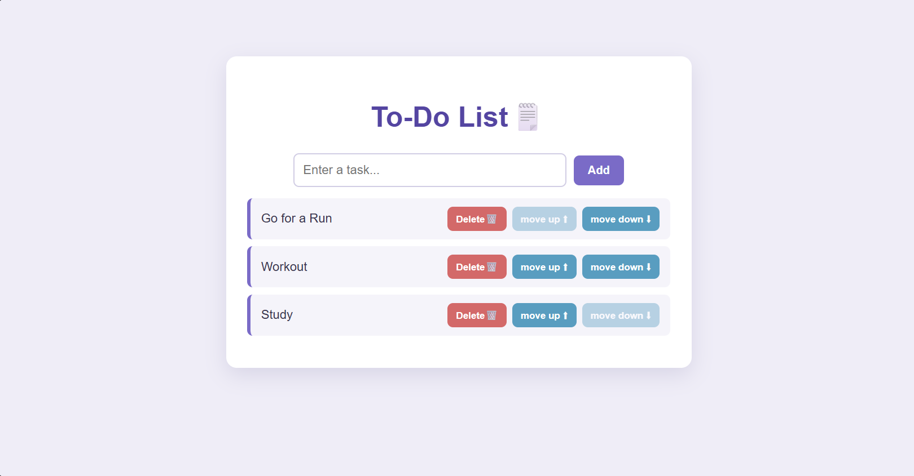

# 🗒️ To-Do List

A simple and clean to-do list app built with **React** and **Vite**, as part of my React learning path.



🔗 **Live demo:** [todo-list-el91.vercel.app](https://todo-list-el91.vercel.app)

## Features

- Add a task with the **Add** button or the **Enter** key
- Empty tasks are ignored
- Delete a task
- Reorder tasks with **move up** / **move down**
- Move buttons are disabled when a task is already first or last

## Tech stack

- [React](https://react.dev/)
- [Vite](https://vite.dev/)
- CSS
- ESLint
- Deployed on [Vercel](https://vercel.com/)

## What I practised

- Building **functional components**
- Managing state with the **`useState`** hook
- Updating arrays **immutably** (spread operator, `filter`, destructuring swap)
- Passing data and functions between components with **props**
- Rendering lists with **`map`** and `key`
- Handling events (`onClick`, `onChange`, `onKeyDown`)

## Project structure

```
src/
├── App.jsx         # Root component
├── ToDoList.jsx    # Holds the state and the logic
├── TaskItems.jsx   # Displays a single task
├── main.jsx        # Entry point
└── index.css       # Styles
```

## Getting started

```bash
git clone https://github.com/El-91/to-do-list.git
cd to-do-list
npm install
npm run dev
```